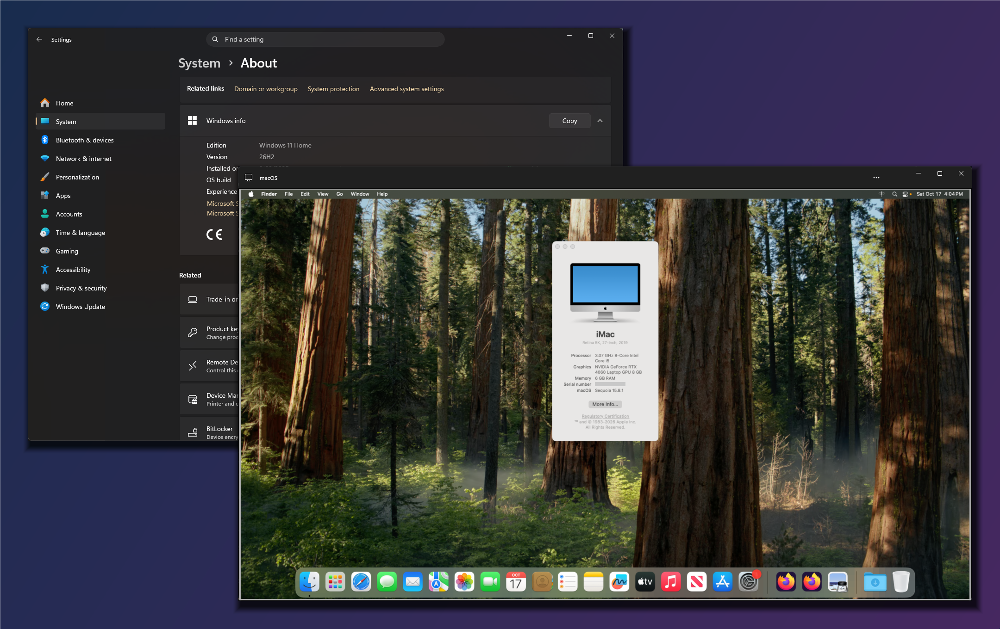

# macOS on Hyper-V with an NVIDIA RTX 4060 (Metal)

macOS 15.8.1 (Sequoia) running in a Hyper-V virtual machine on Windows 11, with the laptop's
RTX 4060 passed through by Discrete Device Assignment (DDA) and accelerated by
[nullmoth/nvidia-macos-driver](https://github.com/nullmoth/nvidia-macos-driver) v2.3.1 plus
the Hyper-V patches in this repository. The GPU is handed back to Windows when macOS shuts
down, without restarting Windows.

This is a personal, noncommercial project. It documents what we built and shares the
patches and scripts; it is not a product or an installer you can run blind.

## Status

What works:

- Metal 3 on the RTX 4060 inside the VM: WindowServer and apps render on the GPU (System
  Information reports "Metal Support: Metal 3").
- GPU handoff: assign the RTX 4060 to the VM, start macOS, shut down, and return the GPU to
  the Windows NVIDIA driver, all without a Windows restart.
- Desktop compositing on the GPU, including blur and vibrancy (Dock, menus, sidebars).
- The "black box in inactive windows" artifact is fixed
  ([docs/black-box-artifact.md](docs/black-box-artifact.md)).

Limits:

- **The display path is laggy.** The RTX 4060 has no monitor here, so every frame is copied
  out of GPU memory into Hyper-V's synthetic framebuffer and then shown through Hyper-V's
  RDP-based console viewer. Rendering is fast; getting pixels to the screen is not.
- **No direct monitor** unless one is connected to the port wired to the RTX 4060 (likely HDMI; untested in the
  VM). The laptop has no MUX: the internal panel is always on the Intel GPU, and the RTX 4060
  reports a single external connector.
- **Streaming** with Sunshine and Moonlight was evaluated: smooth, but it looks like video, and
  NVENC hardware encoding is not usable on pre-Blackwell GPUs with this driver.
- **Static memory only.** DDA does not work with Dynamic Memory
  ([Microsoft: plan for DDA](https://learn.microsoft.com/en-us/windows-server/virtualization/hyper-v/plan/plan-for-deploying-devices-using-discrete-device-assignment)).
- **Unsupported host.** Microsoft documents DDA for Windows Server. On Windows 11 (Pro, or Home
  with Hyper-V enabled as here) it works but is not supported.
- Tested on one machine and one GPU (RTX 4060 Laptop, `10de:28a0`). Device IDs are matched
  explicitly in several places.

See [docs/display-options.md](docs/display-options.md) for the display alternatives.

## Requirements

- Windows 11 with Hyper-V, IOMMU (VT-d) enabled, and a GPU that DDA can dismount. Free GPU
  memory first: assignment is refused while Windows uses the GPU.
- An NVIDIA GPU supported by nvidia-macos-driver (Turing or newer), and an integrated GPU to
  keep the Windows desktop running while the dGPU is in the VM.
- A macOS 15 VM built with [Qonfused/OSX-Hyper-V](https://github.com/Qonfused/OSX-Hyper-V)
  (OpenCore, Generation 2).
- In the guest: Xcode Command Line Tools to build the patched drivers.
- On Windows (for the app): .NET 10 SDK, Windows SDK (`aximp.exe`), Inno Setup 6.

## Setup outline

1. Install macOS in a Generation 2 Hyper-V VM with OSX-Hyper-V. Give the VM static memory,
   `AutomaticStopAction TurnOff`, and enough MMIO space
   (`Set-VM -LowMemoryMappedIoSpace 3GB -HighMemoryMappedIoSpace 32GB -GuestControlledCacheTypes $true`).
2. Enable the hypervisor IOMMU policy for your Windows boot entry
   (`bcdedit /set {default} hypervisoriommupolicy Enable`, then reboot once).
3. In the guest, build and install the patched drivers: [docs/building.md](docs/building.md).
4. Apply the OpenCore changes: [docs/opencore.md](docs/opencore.md).
5. On Windows, fill in `host/machine.json` and use `host/manage-hyperv.ps1 -Action StartSession`
   / `-Action ShutdownAndReturn` (elevated), or build the Windows app in `app/`.

This is a record of one working setup, not a turnkey installer. The patches reproduce the
drivers that ran in the screenshot; the build and helper scripts were cleaned up and
parameterized for publication and have not been re-run from this repository since, so expect
to adapt them.

How it fits together: [docs/architecture.md](docs/architecture.md). What each patch changes and
why: [docs/driver-changes.md](docs/driver-changes.md). Things we learned the hard way:
[docs/lessons.md](docs/lessons.md).

## Repository layout

| Path | Contents |
|---|---|
| `patches/nvidia-macos-driver/` | Patches against nvidia-macos-driver `v2.3.1`: NVAccel/NVRMAGDC Hyper-V carry, Metal plugin fixes |
| `patches/macHyperVSupport.patch` | Patch against acidanthera/MacHyperVSupport `cafcd34`: Support 1.0.9 and Framebuffer 1.0.7 |
| `guest/` | Build and install scripts run inside macOS; MacHyperVHeadlessMetal source |
| `host/` | PowerShell scripts for the VM and GPU lifecycle on Windows |
| `app/` | Windows viewer app and service (WinUI 3, .NET), installer, guest helper sources |
| `docs/` | Documentation |

## Credits

- [nullmoth/nvidia-macos-driver](https://github.com/nullmoth/nvidia-macos-driver): the NVIDIA
  Metal driver for macOS that makes any of this possible.
- [acidanthera/MacHyperVSupport](https://github.com/acidanthera/MacHyperVSupport) (Goldfish64),
  [Lilu](https://github.com/acidanthera/Lilu), [VirtualSMC](https://github.com/acidanthera/VirtualSMC),
  [MacKernelSDK](https://github.com/acidanthera/MacKernelSDK) and
  [OpenCore](https://github.com/acidanthera/OpenCorePkg) by acidanthera.
- [AMFIPass](https://github.com/dhinakg/AMFIPass) by dhinakg.
- [Qonfused/OSX-Hyper-V](https://github.com/Qonfused/OSX-Hyper-V): the Hyper-V OpenCore base.
- NVIDIA [open-gpu-kernel-modules](https://github.com/NVIDIA/open-gpu-kernel-modules) and
  Mesa NVK, used by the upstream driver.
- The Windows app uses [NAudio](https://github.com/naudio/NAudio); its virtual-desktop
  interop was checked against [MScholtes/VirtualDesktop](https://github.com/MScholtes/VirtualDesktop).

## License

- Our own code (host scripts, Windows app, guest scripts, MacHyperVHeadlessMetal) and the
  documentation: [MIT](LICENSE).
- `patches/nvidia-macos-driver/*` modify code licensed under the
  [PolyForm Noncommercial License 1.0.0](https://polyformproject.org/licenses/noncommercial/1.0.0)
  and are distributed under that license, noncommercial use only.
- `patches/macHyperVSupport.patch` modifies BSD-3-Clause code and is distributed under the
  BSD-3-Clause license.

See [NOTICE](NOTICE) for details. macOS is a trademark of Apple Inc.; NVIDIA and GeForce are
trademarks of NVIDIA Corporation. This project is not affiliated with either. Running macOS
in a VM on non-Apple hardware may be restricted by Apple's license terms.
